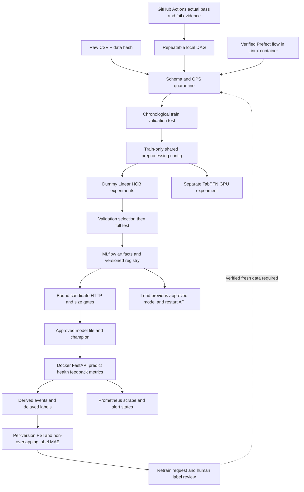

# Food Delivery Time Prediction System — รายงาน CP413008

อัปเดต 11 ตุลาคม 2569 (Asia/Bangkok) จากการตรวจ notebook และ CSV จริง ผลทุกข้อแยกจากการจำลองและข้อที่ยังไม่ได้ทดสอบ รายละเอียดรอบแรกอยู่ใน REPORT_HISTORY_2026-10-10.md; สถานะล่าสุดให้ยึดรายงานนี้และ `evidence/`

## 1. AI Project Canvas และคุณค่าทางธุรกิจ

| องค์ประกอบ | รายละเอียด |
|---|---|
| ปัญหา | ETA ผิดทำให้ลูกค้ารอเกินคาด ร้านวางแผนยาก และเพิ่มการสอบถามสถานะ |
| ผู้ใช้/ผู้มีส่วนได้ส่วนเสีย | ลูกค้า ร้านอาหาร ผู้จัดส่ง และผู้ดูแลบริการเป็นกลุ่มที่เสนอ ผู้ใช้ยืนยันว่ายังไม่มีหลักฐานผู้ใช้จริง/สัมภาษณ์ให้เพิ่ม |
| คุณค่าที่คาดหวัง | ลด ETA error และการร้องเรียน ช่วยตัดสินใจสั่งอาหารและจัดคิว |
| เหตุผลที่ใช้ ML | ระยะทาง จราจร อากาศ ช่วงเวลา และรถมีปฏิสัมพันธ์; เปรียบเทียบจริงกับ Dummy และ Linear แล้ว HGB ลด MAE ได้ |
| Prediction / action | Regression หน่วยนาที ณ เวลาสั่ง แสดง ETA; ไม่ใช้ลงโทษผู้จัดส่ง |
| ข้อมูล | Zomato CSV ที่แนบ 45,584 แถว 20 คอลัมน์ ก.พ.–เม.ย. 2022; ที่มาและสิทธิ์ใช้ production ยังไม่ได้ยืนยัน |
| Inputs | 13 features จากอายุ rating ระยะทาง อากาศ traffic สภาพรถ ประเภทอาหาร/รถ festival city ชั่วโมง/นาที และ flag เวลาหาย |
| Metrics | Optimizing: MAE; ประกอบด้วย RMSE/R²/within ±5 นาที; gates และ SLO ระบุด้านล่าง |
| ความสำเร็จธุรกิจ | เสนอ within ±5 นาที ≥80%, ลดร้องเรียนต่อ 1,000 orders, cancellation ไม่เพิ่ม ต้องยืนยันเป้าหมายและวัด pilot/A-B กับ stakeholder |
| การใช้งาน/ทรัพยากร | HGB realtime FastAPI บน CPU, Docker, MLflow, DAG, Prometheus, GitHub Actions; TabPFN ใช้ RTX 2050 4GB สำหรับทดลอง |
| ผู้รับผิดชอบ/ต้นทุน | ยังไม่มีรายชื่อสมาชิก/การแบ่งงาน/งบประมาณจริง ไม่สร้างข้อมูลแทน |
| ความเสี่ยง | Historical distribution ต่างจากปัจจุบัน; concept drift, label quality, fairness, ไม่มี auth/verified label source/retention enforcement |

ทำนายเร็วเกินทำให้ลูกค้ารอเกินสัญญาและติดต่อ support; ช้าเกินอาจเสียยอดสั่งซื้อ HGB test within ±5 นาที 76.99% ยังต่ำกว่าเป้าหมายที่เสนอ TabPFN ได้ 81.68% บน historical test แต่ยังไม่อนุมัติ serving **ทั้งสองผลไม่ใช่หลักฐานลดร้องเรียนหรือเพิ่มยอดขายจริง**

## 2. ข้อมูล Schema และ shared preprocessing

ตรวจ CSV ทั้งชุด: ไม่มีแถว/ID ซ้ำ พิกัดผิดกรอบบริการ India 4,071 แถวถูก quarantine ตามนโยบาย; เหลือ 41,513 แถว API ปฏิเสธ GPS ผิดหรือระยะทาง >50 km และ category/numeric/time ผิดด้วย 422 ข้อมูล training ผิด critical schema/target/date ทำให้ DAG หยุดก่อน train

| ชุด | แถว | ช่วงวันที่ 2022 |
|---|---:|---|
| Train | 29,674 | 11 ก.พ.–25 มี.ค. |
| Validation | 5,910 | 26–31 มี.ค. |
| Test | 5,929 | 1–6 เม.ย. |

แบ่ง whole date ตาม cumulative 70/85% ไม่มีวันทับซ้อน Median fit จาก train เต็ม estimator ใช้ train-only sample 5,000 seed 42 ทุกโมเดลใหม่ใช้ sample เดียวกัน เวลารับ HH:MM และ Excel fraction 0–1; อายุ/rating ผิดช่วงเปลี่ยนเป็น missing และเติม train median Categories ขาดเติม Unknown ยกเว้น Vehicle_condition ต้องมีค่า ไม่ใช้ target/pickup time/ID/multiple_deliveries เป็น feature

ใช้ `Preprocessor.transform` ชุดเดียวทั้ง training/test/API เก็บ config ของ median/category/order/time policy ลง MLflow และทดสอบ JSON reload ทุก split รวมถึง raw-input model/registry reload รอบ GPU ผ่านจริง Original Colab ใช้ HH:MM-only และ 5,000 แถวแรก จึงไม่ถือผลใหม่เป็นการกู้ fitted model เดิม

หลักฐาน: data_quality.json/config/consistency ใน artifacts, source `food_delivery/preprocessing.py`, tests, bad payload 422 ใน `evidence/container_acceptance.json` และ GitHub data rejection

## 3. โมเดลและการตัดสินใจ

| การทดลอง | Validation MAE | Validation RMSE | Full test MAE |
|---|---:|---:|---:|
| Dummy mean | 7.6885 | 9.4990 | ไม่ใช้เลือกหรือ tune บน test |
| Linear + OneHot | 4.8632 | 6.1044 | ไม่ใช้เลือกหรือ tune บน test |
| HGB | 3.3636 | 4.2420 | 3.4018 |
| TabPFN 9.1.0 / v3.5 checkpoint | 3.1468 | 3.9120 | 3.1479 |

เลือก HGB จากสาม CPU experiments บน validation ก่อน test (max_iter=200, learning_rate=.1, max_leaf_nodes=31, seed42) HGB test RMSE4.2627, R².7888, within5 76.99%; การรันสูตรเดิมซ้ำให้ MAE ตรง tolerance1e-12

TabPFN เป็นการทดลองใหม่ freeze config ก่อน full test: CUDA, n_estimators=1, fit_mode=low_memory, batch16 Test ครบ5,929แถว RMSE3.8965, R².8235, within5 81.68%; test MAE ต่ำกว่า HGB ประมาณ7.46% ไม่ tune จากผล test มี native fitted state/MLflow model/registry reload ผ่าน ดู GPU_REPORT.md และ `evidence/tabpfn-gpu-result.json`

HGB เป็นโมเดลให้บริการเพราะผ่าน quality/latency/throughput/size gates TabPFN ขนาดรวมcheckpoint835.57MiBเกิน100MB และยังไม่วัด GPU HTTP จึงเป็น `quality_passed_not_serving_approved` ไม่เปลี่ยนเกณฑ์ย้อนหลังเพื่อบังคับให้ชนะ การพัฒนาสูตรต่อควรเก็บ test ช่วงเวลาใหม่

## 4. Tracking Registry และ approval

เก็บครบ6ส่วน: source SHA/Git revision, data SHA, hyperparameters, metrics, predictions/config/model artifacts, OS/Python/dependency environment ใน MLflow SQLite/artifact runs มี raw signature/example โหลดจาก logged URI และ Registry URI แล้ว predictions ตรงกัน Config อยู่ทั้ง model และ experiment

Quality gates: validation MAE≤5และดีกว่าDummy; test MAE≤5; reload equivalence Serving gates: p95≤1s, throughput≥10requests/s, error≤1%, artifact≤100MB Candidate ชื่อ `candidate.joblib`; approved file `model.joblib`; Registry มี candidate/champion aliases และ approval tags

แก้การใช้หลักฐานเก่า: checksum candidate, run_id, registry name/version และ dataset hash ต้องตรงกับ HTTP evidence; registry version ต้องเป็น run เดียวกันก่อน approve สร้างไฟล์ใหม่ก่อนสลับ alias และคืนไฟล์เดิมถ้า alias update fail มี regression test CI คำนวณ validation/test predictions ใหม่ ไม่เชื่อ `passed` boolean อย่างเดียว

Docker restart โหลด approved file เดิมเพื่อให้ rollback คงอยู่ การเปลี่ยน model ขณะทำงานต้อง restart และตรวจ readiness/prediction; ไม่ใช่ zero-downtime hot reload และ filesystem/registry ไม่ใช่ distributed transaction Production approval และ incumbent comparison บน fresh verified data ยังต้องกำหนด

## 5. Serving รูปแบบบริการ และ SLO ที่วัดจริง

Realtime REST รองรับ1–100records/คำขอ เหมาะ ETA เมื่อสั่ง HGB CPU และ model lock ใช้งานง่ายในเครื่องกลุ่ม API: `/predict`, `/feedback`, `/health/live`, `/health/ready`, `/metrics` เก็บ request_id/time/registry+version/derived features/predictions/labels ในSQLite ไม่เก็บ exactGPS/personalIDs Error input422, unavailable503, feedback mismatch422/unknown404/duplicate409

Docker build ติดตั้ง Linux environment ใหม่จริง Compose เปิด API8000/Prometheus9090 และ monitor loop ผลผ่าน Windows host เรียก published portของ Linux container:

| Metric | ผล | SLO | สถานะ |
|---|---:|---:|---|
| p50 | 235.64ms | รายงาน | วัดจริง |
| p95 | 341.55ms | ≤1,000ms | ผ่าน |
| Throughput | 16.50requests/s | ≥10 | ผ่าน |
| Error | 0/100 | ≤1% | ผ่าน |

100requests, concurrency4, warmup10, one record/request รวมHTTP/schema/features/predict/log การทดสอบจากhostภายนอกcontainerผ่านจริง แต่ยังไม่มีเครื่องกายภาพที่สอง/internet production/long load หรือหลักฐานmonthlyavailability99.9% Prometheus histogramวัดprocessing แตกต่างจากbenchmarkend-to-end

## 6. Monitoring Retraining และ rollback

Data drift: PSI≥.20 ในfeatureใดก็ได้และอย่างน้อย100feature rows Quality degradation: MAE>max(5,1.2×validationMAE)และอย่างน้อย100labels อาการนี้เป็นconcept drift signal ไม่พิสูจน์ causality ต้องตรวจlabel/traffic/seasonalityร่วมด้วย

Monitorทุก60s เฉพาะregistry+versionปัจจุบัน ไม่ผสมโมเดลเก่า ใช้2หน้าต่างที่ไม่ทับซ้อนกัน แต่ละหน้าต่าง≥100new label rows แล้วสร้าง `retrain_request.json`; last completed quality windowยังแสดงระหว่างสะสมlabelsใหม่ APIรับ feedbackจำลองจริง200labels +12นาทีและcoordinate shift พบdata drift/MAE12/retrain requestตามเกณฑ์ ดู `evidence/container_feedback_drift.json` trafficซ้ำจากbenchmarkทำให้distributionกระจุก ตัวอย่างนี้เป็นการสาธิตการตรวจจับ ไม่ใช่การประเมินdistributionของผู้ใช้จริง

Prometheus scrapeจริงและกฎalertด้านavailability/model ready/errors/processingp95/data/quality กฎdrift/qualityรอ5นาที ระบบdownรอ1นาที ผลfiring/rollbackล่าสุดอยู่ใน COMPLETION_REPORT.md และevidence ไม่มีAlertmanager receiverหรือการส่งแจ้งเตือนถึงบุคคลภายนอก

วงจรสาธิตมี monitor request → retrainบนtarget shiftที่จำลอง → DAG/quality/HTTP gates → isolated registryเวอร์ชันใหม่ → restartAPI → rollback → restartAPIและตรวจprediction นโยบายproductionต้องรับfreshverifiedlabels, temporal split/testใหม่, เทียบincumbentบนvalidationเดียวกัน, อนุมัติและเก็บเวอร์ชันเดิม ไม่อ้างว่ามีข้อมูลใหม่จริง Authentication/retention/label provenanceยังไม่enforce

## 7. DAG Reproducibility Git และ CI/CD

Local DAG: validate→fit/compare/test/register→HTTP gate→approve→monitor บันทึกedges/states/timesและfailureหยุดก่อนtrain ค่าเริ่มต้นรันจริงทั้งWindows/Linux/Docker/GitHub คำสั่ง `docker compose up --build -d` บนvolumeว่างรันครบจนserve restartvolumeเดิมรักษาapprovedmodel Prefect flow/serverรันครบจริงในLinuxcontainerด้วยFastAPI0.136.3/Starlette0.52.1 ดูprefect-attempt.log/prefect-pipeline.json; คู่0.143เดิมมีupstreamcompatibilitybugที่แก้ด้วยpins [Prefect issue22398](https://github.com/PrefectHQ/prefect/issues/22398)

Pin Python3.13.5/dependencies รวมLinuxextrasที่พบจากbuildจริง มีDockerimageที่buildและbootจากrawCSVได้ แนะนำรันDAGใหม่เมื่อย้ายเครื่อง เพราะSQLite/artifactURIเดิมเป็นlocalpaths

Repository https://github.com/ResoKath/MLOPs-KKU-Project, branch `codex/production-completion`, PR https://github.com/ResoKath/MLOPs-KKU-Project/pull/1 เปิดจริงและรักษาไฟล์เดิม; ยังไม่merge GitHubActionscode/schema/recomputedmodelgate/Dockerbuildผ่านจริง และworkflow_dispatchdeploydemoเริ่มcontainer/health/downผ่านในrunner:

- ผ่าน: https://github.com/ResoKath/MLOPs-KKU-Project/actions/runs/38129778934
- deployสาธิตผ่าน: https://github.com/ResoKath/MLOPs-KKU-Project/actions/runs/38129779033
- dataเสียถูกปฏิเสธ: https://github.com/ResoKath/MLOPs-KKU-Project/actions/runs/38129810912 (Vehicle_condition9)
- modelเสื่อมถูกปฏิเสธ: https://github.com/ResoKath/MLOPs-KKU-Project/actions/runs/38129813163 (predictions+20นาที testMAE19.9183)

Runsที่failสองรายการเป็นการตั้งใจทดสอบrejection ไม่ใช่ผลรอบปกติ Deployment runnerชั่วคราวปิดหลังtest ไม่ใช่publicpersistenthosting Commitrevisionของแต่ละrunเก็บใน `evidence/github-*.json`; sourceที่เพิ่มหลังrunต้องรอCIของrevisionล่าสุดด้วย

## 8. สถาปัตยกรรม

## 9. Checklist และข้อคงเหลือ

| ข้อกำหนด | สถานะ/หลักฐาน |
|---|---|
| Canvas/metrics/business | เอกสารมี; stakeholderและbusinesspilotยังไม่มี |
| ≥5000/data/split/schema | ตรวจจริง/chronological/schema failureผ่าน |
| Shared preprocess/config/consistency | ทุกsplitและmodelreloadผ่าน |
| Baseline/≥3experiments/fulltest | CPU3รอบ+TabPFNGPUจริง |
| Tracking6ส่วน/registry/gates | MLflowและboundpromotionผ่าน |
| ContainerAPI/SLO/health/metrics | Linuxbuild/publishedport/benchmarkผ่าน |
| Monitoring/data+conceptsignals | Livefeedbackจำลองและscrapeผ่าน; firingหลักฐานในcompletion |
| Retraining/rollback | Simulationผ่าน; realverifieddata/productionapprovalไม่มี |
| HostedCI/CD/pass+fail3ด้าน | ผ่าน/ปฏิเสธ/runnerdeploymentจริง |
| DAG/onecommand/reproducibility | LocalDAG/Docker/GitHubและPrefectflowในLinuxจริง |
| Git/branch/PR | มีจริงPR1ยังไม่merge |
| รายงาน/architecture | มีเอกสารและMermaid |
| สมาชิก/12min/instructorcases | มีDEMO_GUIDE.md; รายชื่อ/contribution/การนำเสนอ/testcasesวันจริงยังไม่มี |

## 10. AI และการมีส่วนร่วม

ใช้Codexช่วยตรวจnotebook/CSV, ออกแบบและเขียนsharedmodules/API/DAG/monitoring/CI, รันexperimentsและทดสอบ, จัดทำรายงาน/guide/GitPR กลุ่มต้องอ่านและอธิบายโค้ดทุกบรรทัด ส่งความรับผิดชอบตามที่ทำจริง CommitของAIไม่แทนcontributionสมาชิก ไม่อ้างว่าได้สัมภาษณ์ผู้ใช้หรือผ่านtestcaseผู้สอนที่ยังไม่เกิด
