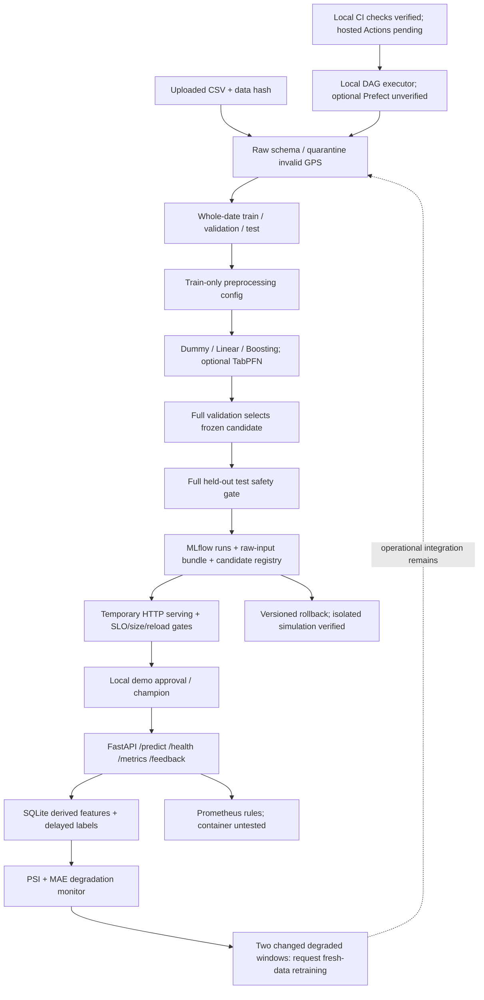

# รายงานการดำเนินงาน Food Delivery Time Prediction System

รายวิชา CP413008 Machine Learning Engineering for Production — สร้างจากไฟล์แนบจริงของผู้ใช้ วันที่ 10 ตุลาคม 2569 (Asia/Bangkok)

## 1. ผลที่ยืนยันได้ และขอบเขตหลักฐาน

ตรวจ `input/mlop.original.ipynb` ทั้ง 70 cells และอ่าน CSV จริง 45,584 แถว 20 คอลัมน์ ดำเนินการทดลองใหม่สามโมเดลบน CPU, ประเมิน full test เฉพาะโมเดลที่เลือกจาก validation, บันทึก MLflow preprocessing config/model/raw signature/provenance, โหลดกลับจาก Registry, เรียก API ผ่าน HTTP, วัด latency/throughput, สาธิต schema failure, จำลอง drift/retraining/rollback, และรัน DAG ภายในครบทุก node การทดสอบล่าสุด 16 กรณีผ่านทั้งหมด

**ยังไม่สามารถอ้างว่าข้อกำหนดครบทุกข้อที่ต้องมีระบบภายนอก**: ไม่มี checkpoint ของ TabPFN เดิม, ไม่มี CUDA, ไม่มี TabPFN ใน runtime นี้; Docker engine ไม่พร้อม; ไม่มี Git remote/PR จริงหรือ GitHub Actions run; Prefect server เริ่มไม่สำเร็จใน sandbox; ไม่ได้ทดสอบบริการจากเครื่องอื่นหรือเก็บผลธุรกิจจากผู้ใช้จริง รายงานใช้คำว่า “เตรียมแล้ว” กับส่วนเหล่านี้อย่างชัดเจน

## 2. AI Project Canvas

| องค์ประกอบ | ข้อเสนอสำหรับโครงงาน |
|---|---|
| ปัญหาและผู้ใช้ | ลูกค้าต้องการ ETA ที่น่าเชื่อถือ ร้านอาหารต้องวางแผนเตรียมอาหาร ผู้จัดส่ง/ผู้ดูแลบริการต้องจัดคิว ทั้งหมดเป็นกลุ่มผู้มีส่วนได้ส่วนเสียที่เสนอ ยังไม่มีหลักฐานสัมภาษณ์หรือผู้ใช้ pilot จริง |
| คุณค่าที่คาดหวัง | ลดความคลาดเคลื่อน ETA ลดการสอบถามสถานะและความไม่พอใจ ช่วยตั้งความคาดหวังก่อนสั่งอาหาร |
| ผู้เสียหายเมื่อทำนายผิด | ทำนายเร็วเกิน: ลูกค้ารอนานกว่าที่สัญญาและติดต่อ support; ช้าเกิน: ลูกค้าอาจยกเลิกหรือไม่สั่ง ร้านเสียยอดขาย ผู้จัดส่งอาจถูกประเมินอย่างไม่เป็นธรรม |
| เหตุผลที่ใช้ ML | ระยะทาง สภาพจราจร อากาศ ประเภทรถ และช่วงเวลามีปฏิสัมพันธ์ที่กฎคงที่จับได้ยาก เปรียบเทียบกับค่าคงที่ Dummy จริง แต่ยังไม่ได้สร้างกฎ ETA แบบธุรกิจเพื่อวัดเพิ่มเติม |
| เป้าหมายธุรกิจ | เสนอ KPI: สัดส่วน ETA ผิดไม่เกิน ±5 นาที ≥80%, อัตราสอบถาม/ร้องเรียนต่อ 1,000 orders ลดลง, อัตรายกเลิกไม่เพิ่ม; เป้าหมายเหล่านี้ต้องให้ stakeholder ยืนยัน |
| ข้อมูลและสิทธิ์ | CSV ที่ผู้ใช้แนบ ช่วง ก.พ.–เม.ย. 2022 มีข้อมูลอายุ rating พิกัด สภาพแวดล้อมเวลาและ target; ไม่ได้รับเอกสารแหล่งที่มา/ใบอนุญาต จึงไม่อ้างว่าอนุญาตใช้ production แล้ว |
| Prediction และ action | regression หน่วยนาที ณ เวลาสั่ง; แสดง ETA ให้ลูกค้าและใช้เป็นข้อมูลช่วยวางแผน ไม่ใช้ตัดสินโทษผู้จัดส่งอัตโนมัติ |
| Inputs ที่ใช้ได้ | 13 features: อายุ rating ระยะทาง อากาศ traffic สภาพรถ ประเภทอาหาร/รถ festival city ชั่วโมง/นาที และ missing-time indicator; ไม่ใช้ target, pickup time, ID หรือ multiple_deliveries |
| การวัดผล | optimizing metric = MAE; รายงาน RMSE, R² และ within-5-minutes; latency/throughput/error rate วัดผ่าน HTTP; ทดลอง A/B แบบจำกัดกลุ่มเพื่อวัด KPI ธุรกิจใน pilot ต่อไป |
| การนำไปใช้/คนและต้นทุน | realtime FastAPI บน CPU สำหรับโมเดลปัจจุบัน; แยก training pipeline ออกจาก API ในแนวทาง production; MLflow Registry เก็บเวอร์ชัน; GPU จำเป็นสำหรับสาธิต TabPFN ขนาดเดิมอย่างเหมาะสม; ค่าเครื่อง/ผู้รับผิดชอบจริงยังไม่ระบุ |
| ความเสี่ยงและกำกับดูแล | public historical data ไม่แทนสภาพปัจจุบัน, synthetic coordinates/labels อาจต่างจากจริง, fairness ตามเมือง/กลุ่มผู้จัดส่งยังไม่ประเมิน, API ยังไม่มี auth/verified labels; ใช้การอนุมัติและ rollback หลังตรวจสอบ |

Test within-5-minutes ได้ 76.99% จึง **ยังไม่ถึงเป้าหมายธุรกิจที่เสนอ 80%** แม้ผ่าน gate เชิงเทคนิค MAE ≤5 นาที ต้องรายงานตามนี้ ไม่ตีความ metric เป็นการลดการร้องเรียนที่เกิดขึ้นแล้ว

## 3. ตรวจข้อมูลและแก้ preprocessing

- ไม่พบแถวซ้ำหรือ ID ซ้ำ พิกัดนอกกรอบ India latitude 6–38 / longitude 68–98 มี 4,071 แถว แยกออกก่อน temporal split เป็นนโยบาย service area ที่ประกาศ ไม่ใช่การลบเงียบเมื่อ API รับข้อมูล; API ปฏิเสธ GPS ผิดและระยะทาง >50 km ด้วย 422
- ข้อมูลที่เหลือ 41,513 แถว ไม่มีการคัดออกเพิ่มจาก distance >50 km
- อายุหาย 1,854, rating หาย 1,908, เวลา Orderd หาย 1,731, multiple_deliveries หาย 993; จำนวนนี้นับจาก CSV เต็ม ดู missing ทุกคอลัมน์ใน `data_quality.json`
- พบเวลาแบบ Excel fraction 4,068 แถว เปลี่ยน parser เป็น HH:MM หรือเศษส่วน 0–1 (1=midnight, ปัดเป็นนาที) โน้ตบุ๊กเดิมแปลงเป็น missing นี่เป็นการปรับ feature policy จึงทดลองใหม่ ไม่แทนค่าผล TabPFN เดิมด้วยผลรอบใหม่นี้
- อายุผิดช่วง 18–65 จำนวน 38 และ rating ผิดช่วง 1–5 จำนวน 53 จัดเป็น missing แล้วเติม median ที่เรียนจาก train เท่านั้น Category null เติม Unknown (ยกเว้น Vehicle_condition ต้องมีค่า); nonnumeric/infinite, category ไม่รองรับ, เวลา malformed, missing critical column และ target ไม่เป็นบวก ทำให้ pipeline หยุด
- `multiple_deliveries` ไม่ใช่หนึ่งใน 13 features และไม่รับประกันว่าทราบ ณ เวลา order creation จึงไม่บังคับเป็น input ของโมเดล/API ป้องกัน error ที่พบในบทสนทนาเดิม
- บันทึกกฎ schema ใน `raw_schema.json` และกฎ/median/domain/feature order ใน `preprocessing_config.json` ใช้ `Preprocessor.transform` ตัวเดียวทั้ง training, validation, test และ `DeliveryModel.predict` ที่ API ใช้

### Split ที่รันจริง

| ชุด | แถว | วันที่ |
|---|---:|---|
| Train | 29,674 | 11 ก.พ.–25 มี.ค. 2022 |
| Validation | 5,910 | 26–31 มี.ค. 2022 |
| Test | 5,929 | 1–6 เม.ย. 2022 |

แบ่ง whole date ตาม cumulative 70/85% ไม่มีวันทับซ้อน ผลตรงกับ split เดิม; ไม่ใช้ random split ข้ามเวลา Median ใช้ train เต็ม; estimator ใช้ train-only sample 5,000 แถว seed 42 ครอบคลุมวันฝึก ต่างจากการใช้ 5,000 แถวแรกในโน้ตบุ๊กเดิม ทุกโมเดลใหม่ใช้ sample เดียวกันเพื่อเปรียบเทียบอย่างยุติธรรม

## 4. การทดลองและการเลือกโมเดล

### ผลรอบใหม่บน full validation

| โมเดล | MAE นาที | RMSE นาที | R² | ผิดไม่เกิน 5 นาที |
|---|---:|---:|---:|---:|
| dummy | 7.6885 | 9.4990 | -0.0000 | 37.23% |
| linear | 4.8632 | 6.1044 | 0.5870 | 58.10% |
| hist_gradient_boosting | 3.3636 | 4.2420 | 0.8006 | 77.09% |

เลือก HistGradientBoosting จาก MAE บน validation ก่อนเปิดดู test ใช้ max_iter=200, learning_rate=0.1, max_leaf_nodes=31, random_state=42 ไม่เพิ่ม tuning หลังเห็นผล test โมเดลฐาน Linear ช่วยให้เห็นประโยชน์จากความสัมพันธ์เชิงเส้น; boosting ลด MAE ต่อจาก Linear ได้ และดีกว่า Dummy จึงเลือกใช้ CPU demo ได้โดยไม่ต้องโหลด foundation checkpoint

### ผล full held-out test ที่รันใหม่

HistGradientBoosting: MAE **3.4018 นาที**, RMSE **4.2627 นาที**, R² **0.7888**, within ±5 minutes **76.99%** ประเมินครบ 5,929 แถว มีไฟล์ predictions ระบุ actual/prediction ให้ตรวจย้อนกลับ

การรันซ้ำด้วยสูตร freeze เดิมให้ test MAE ตรงกันถึง tolerance 1e-12; เป็นการตรวจ reproducibility ไม่ใช่การเลือกสูตรจาก test ถ้าจะพัฒนาสูตรต่อ ต้องเก็บ test ในช่วงเวลาใหม่

### TabPFN: หลักฐานเดิมกับงานที่ยังไม่ได้รัน

Output ใน notebook เดิมระบุ TabPFN 9.1.0, train 5,000, full validation MAE 3.1370, RMSE 3.8906, R² 0.8322 และ registry reload/consistency PASSED นี่เป็น **output ที่แนบมา ไม่ใช่ผลที่ผมรันใหม่** เปรียบเทียบโดยตรงกับรอบใหม่เพื่อสรุปว่าโมเดลใดชนะไม่ได้ เพราะ sample/time preprocessing ต่างกัน

`notebooks/continue_original_tabpfn.ipynb` สร้าง config จาก medians/category ของ original session, ใช้ time policy HH:MM-only เดิม, ตรวจ feature values และ prediction consistency แล้วประเมิน test ทั้งหมดด้วย model_5000 เดิม โดยไม่ refit/tune ชุดนี้ไม่มี output และยังไม่ได้ execute เพราะแนบมาเฉพาะ notebook/CSV ไม่มี weights/session state/MLflow database เดิม ตรวจ syntax ของ code cells แล้วเท่านั้น

อีกทางคือ `--tabpfn --device cuda --out artifacts-tabpfn` เพื่อฝึก **การทดลองใหม่** ด้วย preprocessing ใหม่และบันทึก full test ของ TabPFN แยกจาก winner ทุกพารามิเตอร์ freeze ก่อน test; ยังไม่ได้ทดสอบคำสั่งนี้จริง

## 5. Tracking, Registry และ gates

ทุกการทดลองใหม่เก็บ 6 ส่วน: source SHA-256/Git commit, dataset SHA-256, hyperparameters, validation/test metrics, predictions/config/model artifacts และ Python/OS/library environment ที่รันจริง ดู SQLite `mlflow.db`, artifacts `mlruns/`, `environment.json` และ `requirements.txt` ที่ pin dependency closure ทั้ง direct/transitive แยก marker Windows/Linux เวอร์ชันเพิ่มเติมใน `dependency_snapshot.json`; gunicorn สำหรับ Linux pin ไว้เพิ่มเติม แต่ทั้ง fresh Linux installation และ Docker image ยังไม่ทดสอบ

MLflow model เป็น raw-input bundle ที่มี fitted preprocessing พร้อม estimator มี signature/example และ source code; ทดสอบโหลดจาก logged URI และ Registry URI แล้ว prediction ตรงกัน Config ถูก log ใน MLflow run ไม่ใช่แค่ไฟล์ local

Gate ก่อน candidate: validation MAE ≤5 นาทีและดีกว่า Dummy; full test MAE ≤5 นาที; reload equivalence ผ่าน Gate ก่อน local demo champion: HTTP p95 ≤1 วินาที, throughput ≥10 requests/s, error ≤1%, model size ≤100 MB Candidate ถูกเก็บที่ `candidate.joblib`; `model.joblib` เปลี่ยนแบบ staged replacement หลังผ่าน gate เพื่อรักษาโมเดลเดิมเมื่อ candidate ล้มเหลว สถานะล่าสุด `approved_local_demo` version 4 ขนาด 877,565 bytes

ยังไม่มี gate เปรียบเทียบ incumbent บน **ข้อมูลใหม่จริง** ไม่มี SLO/label-source approval จาก stakeholder และไม่มี production promotion การ rollback ผ่าน alias สาธิตจริงใน registry แยก: [1, 2, 1] โดยโหลดแต่ละเวอร์ชันและยืนยัน predictions กลับตรงเดิม การย้อน actual API ต้อง restart เพื่อโหลด artifact ใหม่; ยังไม่ใช่ hot reload traffic rollback ใน container

## 6. Serving, latency และ SLO

รูปแบบที่เลือก: realtime หนึ่งคำขอรับได้ 1–100 records เหมาะกับ ETA ตอนสั่ง ระบบใช้ model lock เพื่อหลีกเลี่ยง estimator concurrency ที่ยังไม่ทดสอบ จาก raw schema ผ่าน preprocessing ไป prediction บันทึก derived features/request_id/time/model version/prediction ลง SQLite ไม่บันทึกพิกัด GPS ตรงหรือ personal IDs ใน service events

Endpoint: POST /predict, POST /feedback, GET /health/live, GET /health/ready, GET /metrics ข้อมูลผิดคืน 422; model ไม่พร้อมคืน 503; feedback ผิดความยาวคืน 422/ไม่พบ request 404/ส่งซ้ำ 409 Health และ metrics ทดสอบแล้ว

| การวัด HTTP ในเครื่องนี้ | ค่ารอบล่าสุด | SLO ที่เสนอ | ผล |
|---|---:|---:|---|
| p50 | 187.92 ms | รายงานเพื่อเปรียบเทียบ | วัดจริง |
| p95 | 270.03 ms | ≤1,000 ms | ผ่าน |
| throughput | 21.03 requests/s | ≥10 | ผ่าน |
| error rate | 0.00% | ≤1% | ผ่าน |

100 คำขอ, concurrency 4, warmup 10, หนึ่ง record/คำขอ, localhost CPU รวม HTTP/validation/feature/model/event writes ค่าเหล่านี้ **ไม่ใช่ผล network ภายนอก, container, long-running load หรือ GPU TabPFN** และไม่ยืนยัน monthly availability 99.9% Exported latency histogram วัด processing ต่างจาก end-to-end HTTP benchmark

Docker Compose ตรวจโครงสร้างด้วย `docker compose config --quiet` ผ่าน; Dockerfile, container API/Prometheus/monitor loop และ CI container build ยังไม่รันเพราะ Docker engine ไม่มีอยู่ใน session นี้

## 7. Monitoring และวงจร retraining

- Data drift: PSI ≥0.20 อย่างน้อยหนึ่ง feature, minimum 100 rows; มี simulation distance=40 km และตรวจพบจริง
- Quality degradation: delayed-label MAE >max(5 นาที, 1.2×frozen validation MAE), minimum 100 labels; signal นี้ชี้การลดคุณภาพ ไม่พิสูจน์ concept drift โดยลำพัง ต้องตรวจ label quality/สภาวะบริการร่วมด้วย
- จำลอง labels +12 นาทีโดย features เดิม ตรวจพบ label-based degradation; ฝึกใหม่บน train ที่เปลี่ยน target จำลองแล้ว MAE ลดจาก 12.0792 เป็น 3.4274 นาทีบน validation simulation 500 แถว ไม่อ้างว่าเป็นผลข้อมูลใหม่จริงหรือ real held-out production test
- เก็บโมเดลเก่า/ใหม่ใน registry simulation และสลับ alias/โหลดกลับจริงแยกจาก main registry; ผล `drift_retrain_rollback_demo.json`
- `watch.py` ตรวจทุก 60 วินาที มี state ของสอง degraded label windows ที่เปลี่ยนจริงก่อนสร้าง retrain request; ยังต้องเชื่อมการนำเข้าข้อมูลใหม่/ยืนยัน labels/เทียบ incumbent/approval ระบบจริง วงจรอัตโนมัติ end-to-end ที่ทำครบ ณ ตอนนี้เป็น script simulation ไม่ใช่ online retraining deployment
- Metrics ฝั่งระบบ: request success/invalid/error, latency buckets, model ready; Prometheus alert rules สำหรับ availability/error/latency/data drift/quality เตรียมแล้ว ยังไม่ได้ scrape/render dashboard/send alert จริง
- Monitoring traffic ล่าสุดที่สร้างจาก benchmark เป็น repeated example ไม่แทน distribution จริง; ยังไม่มี labels จริงจากผู้ใช้ คุณภาพ production จึงยังประเมินไม่ได้

## 8. DAG, Git และ CI/CD

DAG ภายใน: validate → fit/preprocess/compare/test/register → HTTP gate → approve → monitor บันทึก dependency edges และสถานะ/time ต่อ node ใน `dag_state.json`, ผลใน `pipeline_result.json` ผ่านครบจริง คำสั่งเดียว `python -m food_delivery.pipeline --serve` หลัง gate เปิดบริการต่อ ได้ทดสอบคำสั่งนี้จริงตั้งแต่ CSV จน API readiness/prediction HTTP สำเร็จ แล้วปิด process หลังตรวจสอบตาม `one_command_evidence.json` สาธิตข้อมูลเสียแล้วมีเพียง validate FAILED และยังไม่เริ่ม train ตาม `failed-dag/dag_state.json`

Prefect decorators/flow เตรียมไว้พร้อม `--engine prefect` แต่การเริ่ม server/connect health ล้มเหลวใน sandbox จึงใช้ local DAG เป็นค่าเริ่มต้น ไม่อ้างว่า Prefect flow run ผ่าน

มี local Git main และ feature/production-pipeline พร้อม commits ที่ระบุ author ว่า Codex; เก็บ source revision ใน experiment จริง ไม่มีข้อมูล Git remote ที่ผู้ใช้ระบุ จึงยังไม่ได้ push หรือสร้าง PR จริง `PR_DESCRIPTION.md` เป็นร่างเนื้อหาเท่านั้น ประวัติ commit AI ไม่ใช้แทนประวัติ contribution ของสมาชิก

CI script รันจริงสามด้าน: code quality (Ruff), data schema, model gate มี JSON ของ normal PASSED, data injection FAILED และ model injection FAILED; process ที่ fail คืน exit code ไม่เป็นศูนย์ GitHub Actions เตรียม workflow สำหรับ lint/tests/pipeline/model gate/build/deploy demo แต่ไม่มี hosted workflow run หรือ external deployment evidence

## 9. สถาปัตยกรรม

## 10. Checklist ตามเกณฑ์ CP413008

| ส่วน/ข้อสำคัญ | สถานะ | หลักฐานหรือสิ่งที่ยังต้องทำ |
|---|---|---|
| Canvas / optimizing / gates / business KPI | จัดทำแล้ว; stakeholder validation ยังไม่มี | รายงานส่วน 2 และ 5; KPI ธุรกิจยังไม่วัดจริง |
| Dataset ≥5,000 / temporal split | ผ่านจริง | data_quality.json, tests |
| Schema + corrupt input stops | ผ่านจริง | raw_schema.json, bad_request_demo.json, failed-dag, ci_data.json |
| Reusable preprocessing / config / consistency | ผ่านจริง | preprocessing.py, MLflow config, consistency.json, JSON reload tests |
| Baseline + ≥3 experiments | ผ่านจริง | selection.json; MLflow dummy/linear/boosting |
| Correct TabPFN full test | ยังไม่ได้รัน | continuation notebook และ GPU command พร้อม ไม่มี fabricated output |
| Tracking ครบ 6 ส่วน | ผ่านในรอบใหม่ | run artifacts, environment/data/source hashes, committed source revision |
| Registry / gating / rollback | ผ่าน local และ isolated simulation | gate/approval/reload/demo; real service restart/container rollback ยังไม่สาธิต |
| API health / logs / metrics | ผ่าน local | TestClient, HTTP benchmark, SQLite events |
| p50/p95/throughput เทียบ SLO | ผ่าน local | benchmark.json; ไม่ใช่ container/external load |
| Container + external access | เตรียมแล้ว; ยังไม่รันจริง | Dockerfile/Compose config ผ่าน; engine unavailable |
| Monitoring data/quality/system | ส่วนคำนวณ/simulation ผ่าน; infra ยังไม่ทดสอบ | drift demo/tests; Prometheus scrape/alerts outbound pending |
| Retraining policy / cycle | simulation ผ่าน; production integration คงเหลือ | monitor policy, demo; ต้องมี fresh verified labels |
| CI/CD สามด้าน + pass/fail | local checks ผ่านและสาธิต fail; hosted ยังไม่รัน | ci_normal/data/model.json; workflow YAML |
| Repeatable DAG / one-command raw→service | local DAG ผ่าน; container bootstrap ไม่รัน | pipeline_result.json, dag_state.json, README |
| Git branch / PR | Git/branch มีจริง; PR ยังไม่มี | local history/bundle; PR description prepared |
| Pinned versions / machine-empty reproducibility | pins และ deterministic repeat มี; fresh install ยังไม่ทดสอบ | requirements.txt, reproducibility.json |
| Presentation / individual contributions / instructor tests | เตรียม guide; ยังไม่เกิดการสาธิตจริง | สมาชิก/ประวัติ contribution/test cases วันนำเสนอผู้ใช้ต้องเพิ่มเติม |

## 11. แนวทางสาธิต 12 นาที และการใช้ AI

แบ่งเวลา: 0–2 นาทีโจทย์/คุณค่า/Canvas; 2–4 นาที schema+เวลา Excel+temporal split; 4–6 นาทีสาม experiments และ test; 6–8 นาที API/latency/registry; 8–10 นาที bad input/drift/retrain/rollback; 10–12 นาที DAG/CI/checklist และข้อจำกัด แล้ว Q&A 3 นาที สมาชิก 5–7 คนแบ่งผู้รับผิดชอบแต่ละส่วนตาม contribution จริง ไม่สร้างชื่อหรือประวัติแทนสมาชิก

ใช้ Codex ช่วยตรวจ notebook/CSV, เขียน reusable modules/API/pipeline/tests/config/รายงาน และรันหลักฐานในเครื่องนี้ สมาชิกต้องอ่านและอธิบายโค้ดที่ส่งทุกส่วนได้ตามข้อกำหนด ไม่มีการอ้าง AI commits เป็น contribution ของนักศึกษา

## 12. เอกสารอ้างอิงและลำดับงานที่คงเหลือ

อ้าง API/workflow จาก [MLflow sklearn](https://mlflow.org/docs/latest/api_reference/python_api/mlflow.sklearn.html), [MLflow Registry](https://mlflow.org/docs/latest/ml/model-registry/workflow/), [TabPFN official repository](https://github.com/PriorLabs/TabPFN), [Prefect workflow tutorial](https://docs.prefect.io/latest/tutorial/flows), [FastAPI Docker](https://fastapi.tiangolo.com/deployment/docker/) ใช้ประกอบการออกแบบ ไม่ใช่หลักฐานการรันของโครงงาน

ก่อนสาธิตให้ครบ rubric: (1) รัน frozen original TabPFN test บน GPU session และแนบผล (2) เปิด Docker engine แล้ว build/run/call API จากภายนอก/วัดซ้ำ (3) ระบุ remote แล้ว push/open PR และรัน Actions จริงรวม failed run (4) ทดสอบ monitor infrastructure/alerts และ real service rollback (5) ยืนยัน stakeholder/KPI/source rights/verified labels และเก็บ contribution สมาชิก หลักฐานเหล่านี้ยังไม่มี ณ วันที่สร้างรายงาน
